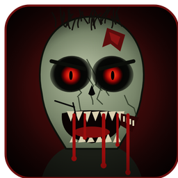
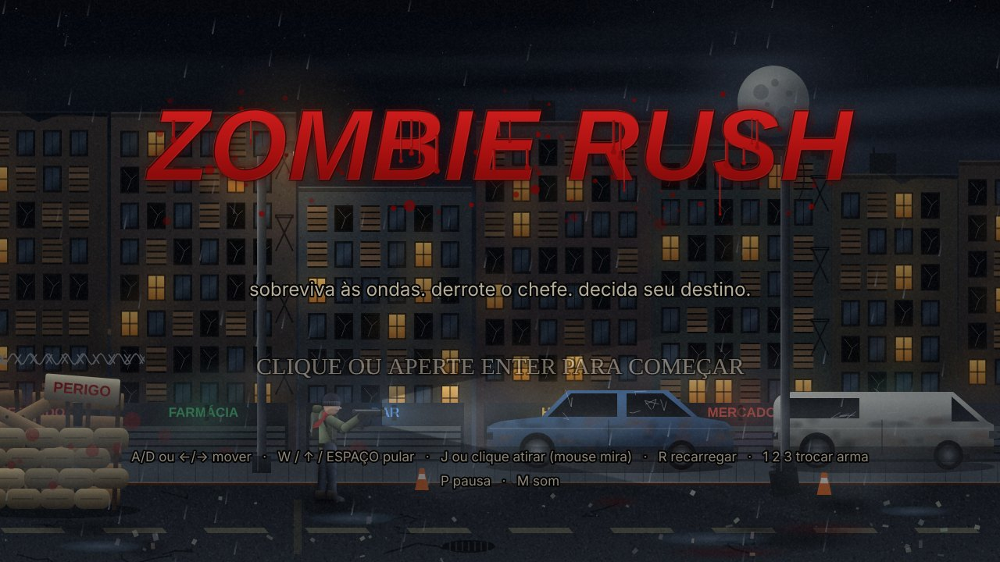
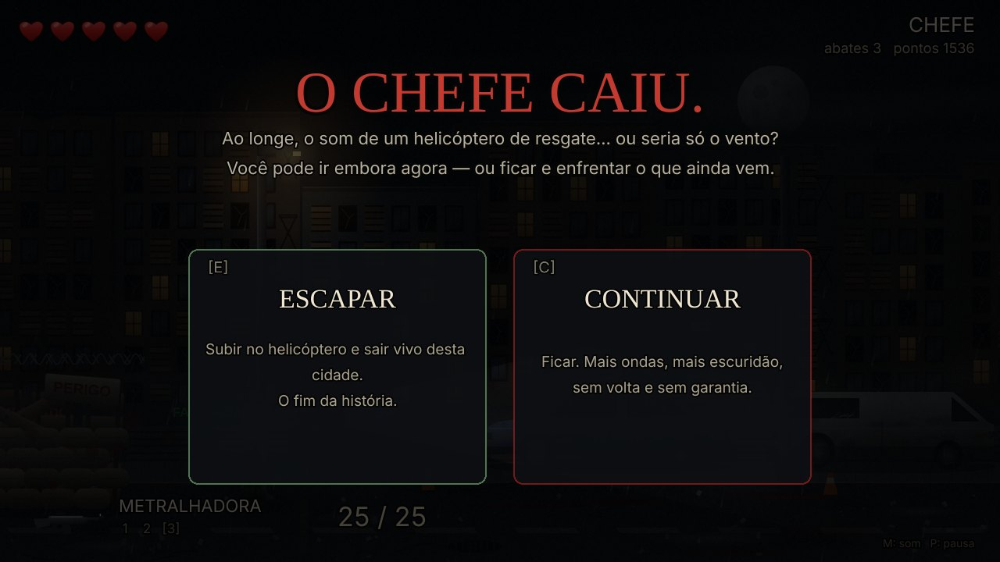
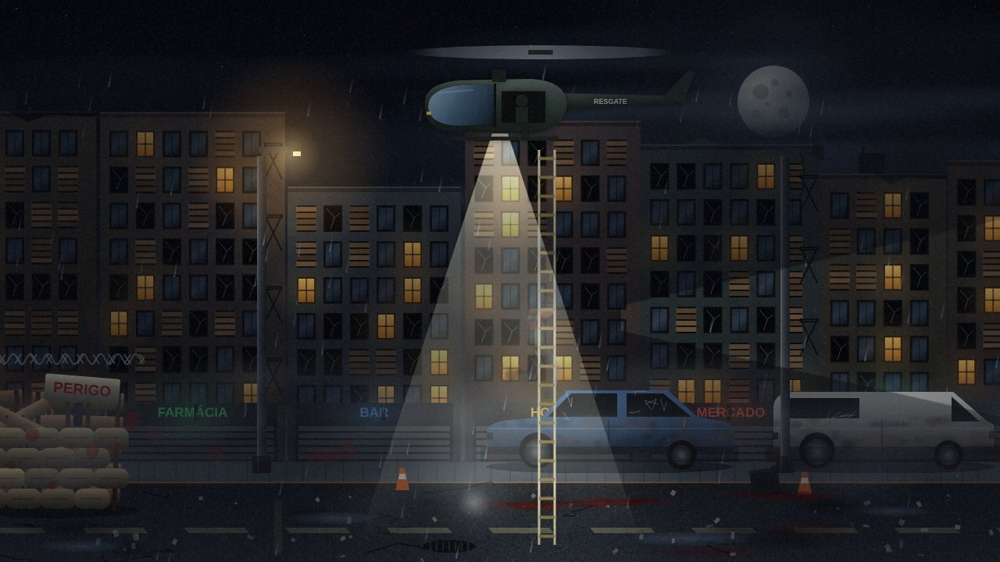
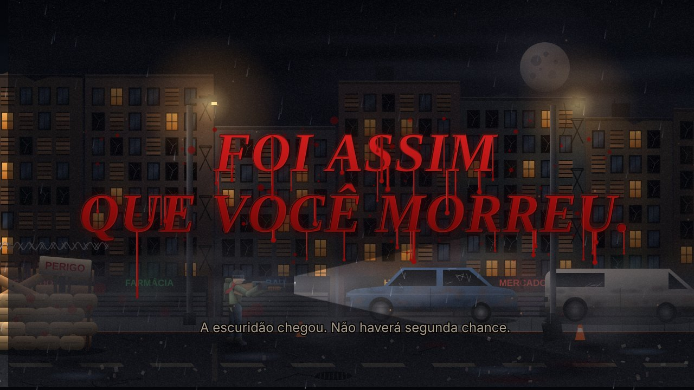
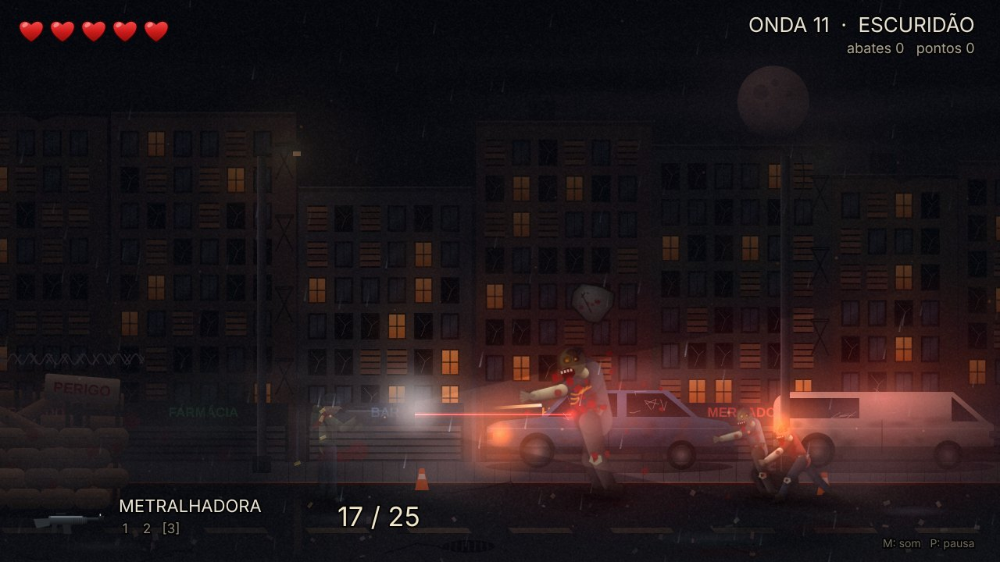
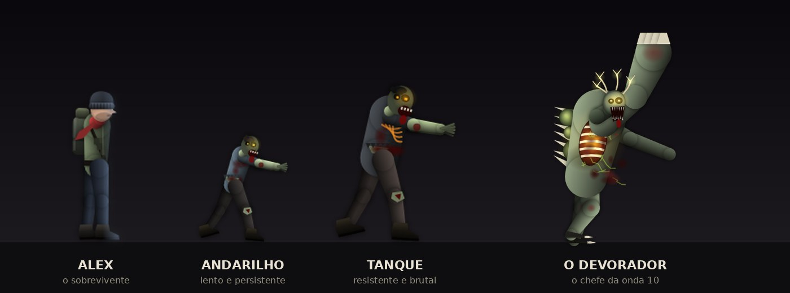
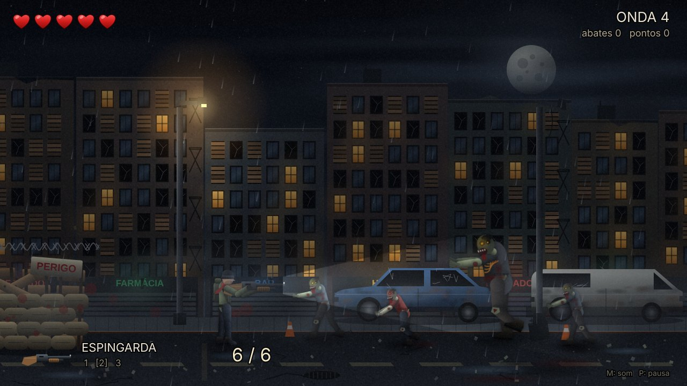

# ZOMBIE RUSH

**Sobreviva às ondas. Derrote o chefe. Decida o seu destino.**

Jogo 2D de ação e sobrevivência com visão lateral, feito em Phaser 3 (WebGL).

---

## Sobre o jogo

*Zombie Rush* é um jogo de ação e sobrevivência por ondas. Você controla um sobrevivente preso em um trecho de rua barricado, em uma cidade tomada por um surto. Os zumbis chegam **sempre pelo mesmo lado da tela**, em linha reta, e a cada onda ficam mais numerosos, mais rápidos e mais resistentes.

Você anda para a esquerda e para a direita, **pula** para fugir do contato e atira. Entre uma onda e outra, escolhe uma melhoria e, em dois momentos da campanha, decide se troca de arma ou continua com a atual.

O jogo tem um final de verdade. Na **onda 10** aparece um chefe, e quando ele cai você precisa tomar uma decisão que muda tudo: **escapar de helicóptero ou ficar**.

---

## A história

### A cidade

Tudo começou à noite, na chuva. Ninguém sabe dizer em que hora o surto saiu do controle. Primeiro foram as sirenes, depois o silêncio. Quando a infecção chegou ao centro da cidade, o mercado, a farmácia, o bar e o hotel da avenida principal já estavam vazios, com as luzes de emergência ainda acesas e as vitrines quebradas por dentro.

Os poucos sobreviventes que restaram tentaram fechar a rua com o que tinham: sacos de areia, restos de madeira, arame farpado e uma placa torta escrita **PERIGO**. Carros foram abandonados no meio da pista, alguns com a porta aberta e a chave na ignição. Quase todo mundo que montou aquela barricada não está mais lá. Só o que eles deixaram: armas, munição, suprimentos e um poste de luz que ainda insiste em funcionar.

### Alex

Você é **Alex** (nome provisório). Uma pessoa comum, com gorro, mochila e um lenço vermelho no pescoço, pega de surpresa pela infecção. Não é soldado nem herói. Quando o resto da cidade caiu, ficou isolado nesse trecho de rua, sem rota de fuga e sem ninguém para pedir ajuda.

O objetivo, no começo, é pequeno: **passar a noite**. Atrás de Alex fica a barricada, e na frente, a escuridão de onde os zumbis vêm.

### Ato I: A barricada (ondas 1 a 3)

Os primeiros infectados chegam devagar, arrastando os pés, em pequenos grupos. São os **andarilhos**: lentos, fracos e persistentes. Alex só tem uma pistola de 12 balas e precisa aprender o ritmo da rua, que é atirar, pular e recarregar na hora certa.

Nessas ondas Alex encontra seus primeiros recursos. Ao fim da **onda 3**, entre os restos deixados por outros sobreviventes, está uma **espingarda**. Alex pode pegá-la e deixar a pistola de reserva, ou ficar com a arma que já conhece.

### Ato II: A noite aperta (ondas 4 a 9)

A tensão cresce. Chegam os **corredores**, que atravessam a rua em segundos e não perdoam um erro. Depois vêm os **tanques**, enormes, lentos e brutais, que aguentam muitos tiros e machucam de verdade.

Na **onda 6**, uma **metralhadora** surge, e junto com ela uma escolha de estilo de jogo. O que Alex veste, carrega e aprende a cada onda forma a sua própria build, porque cada partida é diferente.

A **onda 9** é a última antes do silêncio. A chuva aperta, o vento muda e o chão começa a tremer.

### Ato III: O Devorador (onda 10)

Algo muito maior que os outros sai da escuridão. **O Devorador** é uma massa de carne, espinhos e ossos, que ruge, esmaga o chão com um golpe e manda uma onda de choque pela rua, que Alex só evita pulando. Ele chama a horda com o próprio rugido e, quando ferido, passa a **cuspir ácido**.

Derrubar o Devorador não é só vencer um inimigo. É sobreviver a uma noite que parecia que não ia acabar.

### A decisão

Com o chefe caído, o tempo desacelera e a música muda para algo sombrio. Ao longe, um som que parecia impossível: **um helicóptero de resgate**, ou talvez só o vento.

> **O CHEFE CAIU.**
> Você pode ir embora agora, ou ficar e enfrentar o que ainda vem.

#### Final 1: Escapar

Se Alex decide **escapar**, o som das pás cresce até cobrir a chuva. O helicóptero com a marca **RESGATE** desce sobre a rua, o holofote varre o asfalto e uma escada de corda cai bem na frente de Alex. Ele corre, sobe, e a cidade vai ficando para baixo, pequena e apagada.

> **PARABÉNS! VOCÊ SAIU VIVO.**

#### Final 2: Continuar

Se Alex decide **ficar**, tudo muda. Um relâmpago corta o céu e uma frase manchada de sangue aparece na tela:

> **FOI ASSIM QUE VOCÊ MORREU.**

Não é uma ameaça, é um aviso. A partir daí a cidade fica diferente. O céu avermelha, os postes de luz piscam e falham, os alarmes dos carros disparam e ecoam pela rua, e a lanterna presa à arma de Alex começa a falhar em momentos aleatórios, deixando-o às cegas por alguns segundos. A música sombria nunca mais para, e o coração acelera conforme a vida diminui.

As ondas seguintes são mais numerosas e mais duras, e entre os tanques surge um que **arremessa pedras**, que rolam pela rua e só podem ser evitadas com um pulo. Não existe mais final feliz, só a pergunta de **até onde Alex consegue ir** antes de a escuridão levá-lo.

---

## Personagens

| Tipo | Aparece | Comportamento |
|---|---|---|
| **Andarilho** | desde a onda 1 | Lento, pouca vida. A base da horda. |
| **Corredor** | a partir da onda 2 | Veloz, pouca vida. Cobra reação rápida. |
| **Tanque** | a partir da onda 4 | Lento, muita vida e dano alto. Aguenta muitos tiros. |
| **Tanque lançador** | depois da onda 10 | A cada 5 tanques, um arremessa pedras que rolam pelo chão e exigem um pulo. |
| **O Devorador** (chefe) | onda 10 | Golpe no chão com onda de choque, rugido que chama zumbis e cuspe de ácido quando ferido. |

---

## Como o jogo funciona

### Ondas
- **Ondas 1 a 9:** hordas crescentes, com zumbis mais fortes a cada onda.
- **Onda 10:** o chefe.
- **Ondas 11 em diante:** só existe se você escolher continuar. Fica mais escuro, mais numeroso e sem previsão de fim.

### Armas

O jogo tem recarga, e cada arma tem seu pente e seu tempo de recarga.

| Arma | Quando desbloqueia | Pente | Característica |
|---|---|---|---|
| **Pistola** | início | 12 | Precisa e confiável. |
| **Espingarda** | onda 3 | 6 | 7 projéteis por tiro, devastadora de perto. |
| **Metralhadora** | onda 6 | 25 | Rajada veloz, com mira laser vermelha. |

Ao desbloquear uma arma nova, **você escolhe se troca ou não**.

### Melhorias

Ao fim de cada onda você escolhe **1 entre 3 melhorias**, sorteadas entre as disponíveis. Cada uma tem um limite de vezes que pode ser pega, para ninguém ficar invencível.

| Melhoria | Efeito | Máx. |
|---|---|---|
| Calibre Pesado | +20% de dano | 5 |
| Gatilho Leve | +12% de cadência | 4 |
| Pente Estendido | +2 munições em todos os pentes | 5 |
| Recarga Rápida | recarrega 22% mais rápido | 3 |
| Balas Perfurantes | o tiro atravessa +1 zumbi | 3 |
| Colete Reforçado | +1 coração máximo e cura total | 3 |
| Botas de Corrida | +8% de velocidade | 4 |
| Adrenalina | +0,4 s de invulnerabilidade ao ser ferido | 3 |
| Sede de Sangue | a cada 12 abates (ou 8 no nível 2) recupera 1 coração | 2 |
| Kit de Emergência | cura total | sem limite |

### Dificuldades

| Nível | Corações | Zumbis | Chefe | Cura entre ondas |
|---|---|---|---|---|
| **Fácil** | 6 | normais | ×1,1 de vida | 1 coração |
| **Normal** | 5 | +30% de vida e de quantidade | ×1,6 de vida | 1 coração |
| **Pesadelo** | 4 | +75% de vida, +70% de quantidade, mais rápidos | ×2,3 de vida | nenhuma |

### Controles

| Ação | Teclado / Mouse |
|---|---|
| Mover | `A` / `D` ou `←` / `→` |
| Pular | `W`, `↑` ou `Espaço` |
| Atirar | `J` ou clique (o mouse mira) |
| Recarregar | `R` |
| Trocar de arma | `1`, `2`, `3` |
| Pausa | `P` |
| Som | `M` |
| Tela cheia (versão Windows) | `F11` |

Há também botões na tela para celular.

---

## Tecnologia

- **[Phaser 3](https://phaser.io/)** com WebGL: camadas, iluminação dinâmica, névoa, chuva e partículas.
- **Arte desenhada por código:** cenário, personagens e efeitos são pintados proceduralmente em canvas 2D, com gradientes, luz de contorno e sombras. Os sprites podem ser trocados por arte final no futuro.
- **Áudio com Web Audio API:** música ambiente, tema do chefe e música sombria geradas por síntese, junto com os sons do próprio projeto (gritos, gemidos, mordida e outros).
- **Electron:** empacota o jogo como um executável para Windows.

---

## Equipe

Projeto da disciplina **Introdução ao Desenvolvimento de Jogos**.

- Juscelino Junior
- João Vitor
- Joeberty Deicson
- Ismael Menezes

---

## Status

Protótipo jogável com loop completo: ondas, armas, recarga, melhorias, dificuldades, chefe e os dois finais.

**Ideias para o futuro**
- Arte final em pixel art no lugar da arte procedural
- Mais chefes e mais tipos de zumbi
- Vendedor de melhorias entre ondas (NPC)
- Placar com recordes
- Versão mobile
